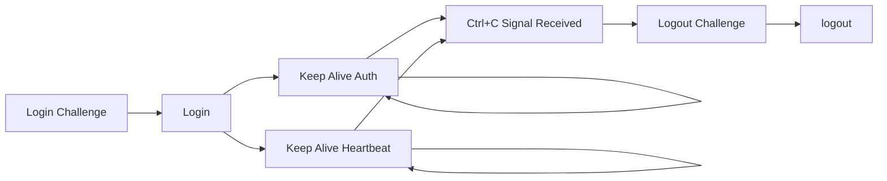
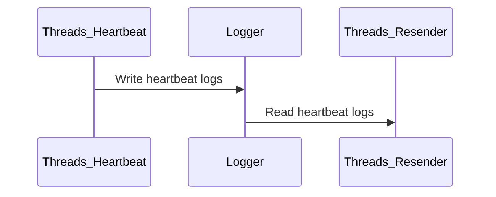

# Jilin University Campus Network Authentication Client (C Version)

Based on the official Linux authentication client provided by the university, it is designed for POSIX-compliant environments (Linux, BSD, Cygwin, etc.)

## Motivation for Developing the Client

Primarily developed to address the following issues:

1. The university officially provides only a GUI client.
2. Existing C/C++ implementations on GitHub are outdated and suffer from UDP packet loss/disconnections on the campus network.
3. Clients running on Java and Python interpreters are too bloated.

## Campus Network Authentication Protocol

The Jilin University campus network utilizes the DRCOM D-version authentication protocol (UDP). For detailed information regarding the DRCOM protocol, please refer to the [GitHub DRCOM repository](https://github.com/drcoms)

## Client Execution Flow



1. Send a login challenge to obtain a salt for authentication.
2. Use the salt to construct the login packet and authenticate the account.
3. Send two types of heartbeat packets to maintain the connection, while the program listens for the Ctrl+C signal (SIGINT) in the Linux terminal.
4. Upon receiving the SIGINT signal, execute the logout process: send a logout challenge, obtain a salt, and then complete the logout.

## Client Implementation

1. After the main process completes steps 1 and 2 above, it starts two independent threads (using pthread) to send different heartbeat packets.
2. In practice, the UDP protocol experiences packet loss in the campus network environment, causing the authentication server to miss heartbeat packets and disconnect the client. To mitigate UDP packet loss, the client uses a Logger to record the previously sent heartbeat packets, send times, send counts, and reply counts. A Resender monitors these logs; if no server response is received within 2 seconds after sending a heartbeat packet, it will be resent. If there is no response after 3 retry attempts, the client exits. The Resender consists of 2 independent threads, each responsible for resending one type of heartbeat packet.



## How to Use

### Download the Repository

```bash
git clone https://github.com/AndrewLawrence80/jlu-drcom-client.git
```

### Modify Configuration

Modify ``config.h``

``` cpp
#define CONFIG_USERNAME "xiaoming22" // 邮箱账户，无@后缀
#define CONFIG_PASSWORD "xiaoming123456" // 邮箱密码
#define CONFIG_IP "192.168.1.100" // 校园网IP
#define CONFIG_MAC "\x00\x00\x00\x00\x00\x00" // 校园网IP关联的MAC地址
#define CONFIG_HOST_NAME "xiaoming-linux" // 主机名，linux可以在命令行运行hostname
#define CONFIG_OS_INFO "5.10.0-amd64" // 操作系统版本，linux可以在命令行运行uname -r
```

### Install Dependencies

Debian/Ubuntu

```bash
sudo apt install build-essential binutils linux-headers-amd64 make gcc
```

### Local Compilation

Compile for the machine where the code resides / machines with the same instruction set.

```bash
make
```

### Cross-Compilation

Compile for machines with different instruction sets, using OpenWrt as an example.

#### Download the Cross-Compilation SDK

Download the SDK for the corresponding instruction set from the [OpenWrt download page](https://downloads.openwrt.org/snapshots/targets/), for example, the [MT7621 SDK](https://downloads.openwrt.org/snapshots/targets/ramips/mt7621/openwrt-sdk-ramips-mt7621_gcc-12.3.0_musl.Linux-x86_64.tar.xz), and extract it.

#### Modify the Makefile

``` Makefile
export PATH := $(PATH):[解压路径]/openwrt-sdk-[版本]-[指令集]_gcc-[gcc版本]_[libc版本].Linux-x86_64/staging_dir/toolchain-[指令集]_gcc-[gcc版本]_[libc版本]/bin/
export STAGING_DIR := [解压路径]/openwrt-sdk-[版本]-[指令集]_gcc-[gcc版本]_[libc版本].Linux-x86_64/staging_dir/toolchain-[指令集]_gcc-[gcc版本]_[libc版本]/
CC=[上述toolchain/bin目录下的gcc]
LD=[上述toolchain/bin目录下的ld]
# CC=gcc
```

For more information on compiling under OpenWrt, refer to the [OpenWrt official documentation](https://openwrt.org/docs/guide-developer/toolchain/crosscompile)

### Keep Running in the Terminal

Use [Screen](https://linuxize.com/post/how-to-use-linux-screen/) on Linux.

## Acknowledgments

[GitHub DRCOMS](https://github.com/drcoms/drcom-generic)
[GitHub ly0](https://github.com/ly0/jlu-drcom-client)
[GitHub mchome](https://github.com/mchome/dogcom)
[Github Yesterday17](https://github.com/Yesterday17/go-drcom-jlu)
[Github youthlin](https://github.com/youthlin/jlu-drcom-client)

## Regarding Issues

[The Art of Asking Questions](https://github.com/ryanhanwu/How-To-Ask-Questions-The-Smart-Way/blob/main/README-zh_CN.md)

1. Describe your issue in detail.
2. Steps to reproduce.
3. Program logs.
